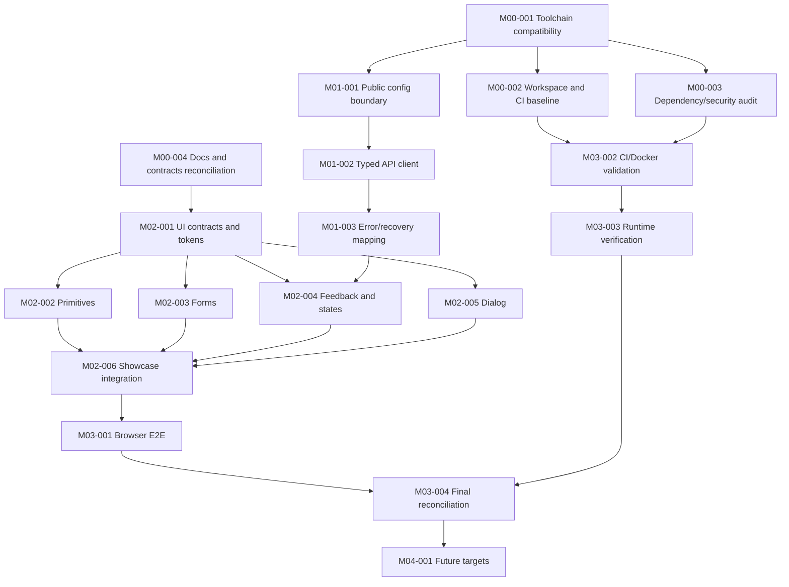

# Dependency Graph

## Scheduling notes

- M00-003 can run alongside M00-002 after M00-001; M00-004 is already documented with limitations.
- M02-002, M02-003, and M02-005 may run in parallel only after M02-001 fixes shared component conventions and each task has separate file ownership.
- M02-004 depends on the error contract from M01-003.
- M02-006 is an integration gate; do not parallelize it with component API changes.
- M03-004 is a final integration/security gate.
- No dependency cycle is present in this directed acyclic graph.
