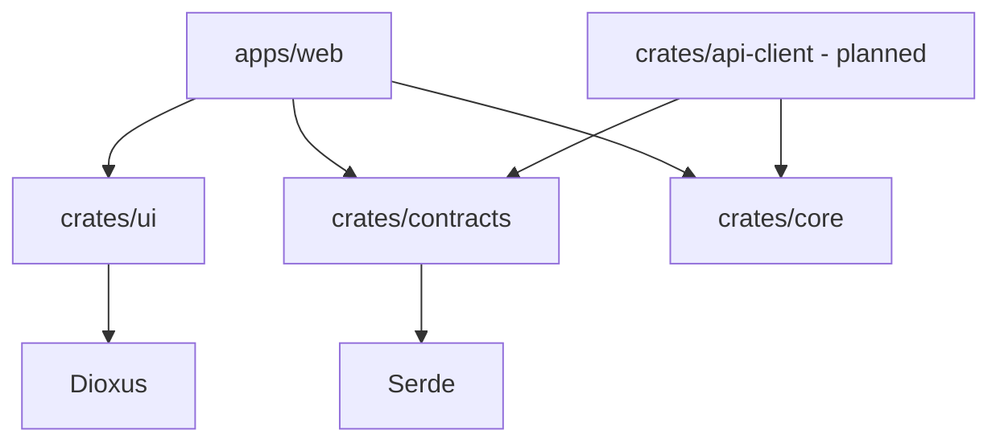

# Dependency Rules

## Canonical rules

1. Dependencies flow inward from application composition to reusable libraries; shared libraries never depend on apps/web.
2. `mw-core` stays framework-, UI-, and transport-independent.
3. `mw-contracts` may use serialization and validation dependencies only; it must not import Dioxus, UI, HTTP clients, or database implementations.
4. `mw-ui` may depend on Dioxus and narrowly justified shared primitives; it must not perform API transport or own product-domain behavior.
5. A future API client depends on contracts/core, never on UI.
6. `xtask` is development tooling, not a runtime dependency.
7. Server-only dependencies must be target-gated and excluded from browser/WASM builds.
8. Root Cargo.toml is the source of truth for shared dependency versions.
9. Avoid adding a crate solely to mirror a proposed directory tree.
10. No unsafe Rust without a documented safety rationale and review.

## Allowed dependency graph

## Enforcement

For each new dependency or workspace edge, the owning task must:

- State why an existing crate cannot own the capability.
- Add the smallest required feature set.
- Check native and `wasm32-unknown-unknown` compatibility where relevant.
- Run `cargo tree --workspace` and inspect unexpected transitive/server dependencies.
- Run workspace check, clippy, tests, and WASM check.
- Update this document only when the architecture rule itself changes.

## Review checklist

- [ ] No cycle is introduced.
- [ ] No contracts-to-UI or contracts-to-transport edge exists.
- [ ] No UI-to-API-client edge exists.
- [ ] No server-only crate leaks into WASM.
- [ ] Shared versions remain centralized.
- [ ] New crates have a clear owner and at least one real consumer.
